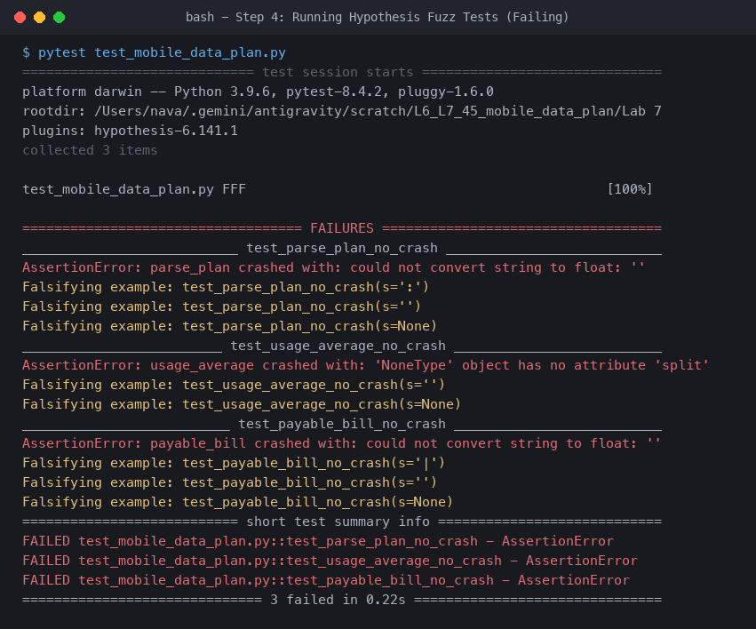
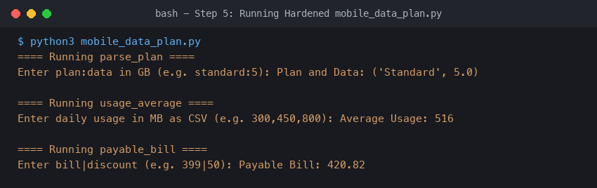
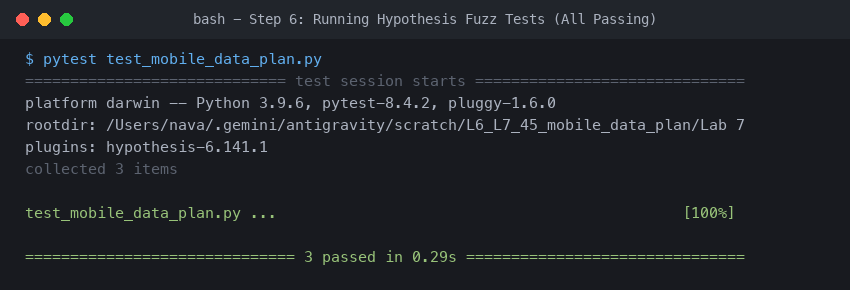

# Lab 7: Fuzzing for Input Validation Bugs

**Student Name:** Navaneeth Tanuboddi  
**SRN:** PES1UG24CS709  
**Assigned Topic / Repo:** `L6_L7_45_mobile_data_plan`

---

## 🎯 Lab Objectives
- Understand the methodology and purpose of fuzz testing using property-based fuzzing.
- Use the **Hypothesis** library in Python to generate random, unexpected, and malformed inputs.
- Detect input validation edge-case bugs and exceptions (e.g., `NoneType`, empty strings, missing delimiters, malformed numeric formats, division by zero).
- Apply defensive programming techniques to harden functions against unexpected inputs and crashes.

---

## 📁 Files in this Directory
- **`mobile_data_plan.py`**: Hardened Python script with input validation and defensive checks.
- **`test_mobile_data_plan.py`**: Fuzz test suite using Hypothesis (`@given(st.text() | st.none())`).
- **`Lab7_Fuzzing_Report.pdf`**: Complete PDF report including all execution screenshots and analysis.
- **Screenshots:**
  - `step2_buggy_output.png`: Initial run of buggy application.
  - `step4_test_failures.png`: Failing fuzz tests exposing edge-case bugs.
  - `step5_fixed_output.png`: Verification run of the hardened application.
  - `step6_test_passed.png`: Fuzz tests passing completely on hardened code.

---

## 🔬 Lab Steps & Verification

### Step 1: Install Dependencies
```bash
pip install hypothesis pytest
```

### Step 2: Run Buggy Application
Run the original script with sample input:
```bash
python mobile_data_plan.py
```


### Step 3 & 4: Implement Hypothesis Fuzz Tests & Detect Bugs
Fuzz tests generated arbitrary strings and `None` values, exposing critical unhandled exceptions:
- `AttributeError: 'NoneType' object has no attribute 'split'`
- `ValueError: not enough values to unpack (expected 2, got 1)`
- `ValueError: could not convert string to float: ''`
- `ZeroDivisionError: integer division or modulo by zero`
```bash
pytest test_mobile_data_plan.py
```


### Step 5: Harden Application (`mobile_data_plan.py`)
Defensive programming practices implemented:
- Verified string types via `isinstance(s, str)` to reject `None` and non-string types safely.
- Checked delimiter occurrences (`:` and `|`) before unpacking.
- Stripped whitespace and rejected empty string segments.
- Validated float/int conversions inside `try/except (ValueError, OverflowError)`.
- Protected against `NaN`, `Infinity`, negative numbers, and empty lists.
```bash
python mobile_data_plan.py
```


### Step 6: Re-run Fuzz Tests
All 3 tests executed across hundreds of randomized fuzzed inputs with **0 crashes**:
```bash
pytest test_mobile_data_plan.py
```

```text
============================== 3 passed in 0.29s ===============================
```
